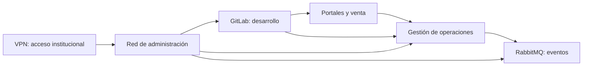

# Operación Faro · Recuperación de servicios y revisión de una atribución personal

**INFORME DOCENTE BASADO EN UN CASO REAL · Versión censurada y adaptada con datos de prueba.** No se publican identidades ni evidencias originales del caso. Las referencias E corresponden a evidencias simuladas del [expediente](expediente.md). Las referencias T describen documentación técnica real; no acreditan los sucesos del escenario.

## Portada y control del documento

| Campo | Contenido |
|---|---|
| Autoría | Equipo de análisis del supuesto académico Operación Faro |
| Destinatario | Comité de continuidad y dirección de la organización ficticia RIFSB |
| Entidad | Red Internacional de Formación y Servicios Boreamar |
| Fecha y versión | 22 de mayo de 2026 · Versión docente 1.0 |
| Periodo de los hechos | 4 a 22 de mayo de 2026 |
| Corte de información del escenario | 22 de mayo de 2026, 12:00 UTC |
| Preparación y consulta de referencias técnicas | 19 de octubre de 2026; reconstrucción docente posterior |
| Difusión en el supuesto | Comité y equipo de respuesta; copia académica sin datos reales |
| Encargo | Decidir las condiciones de recuperación, conservación de evidencias y corrección de una atribución personal |

### Historial de versiones del supuesto

| Versión | Momento del escenario | Cambio |
|---|---|---|
| 0.1 | 13 de mayo | Preguntas, inventario y separación de hechos y acusaciones |
| 0.2 | 18 de mayo | Recuperación de gestión, GitLab y revisión de eventos |
| 0.3 | 21 de mayo | Contraste de emisión, uso y entrega de la VPN; retirada de la atribución |
| 1.0 | 22 de mayo | Valoración al corte y prioridades de cierre |

Estas versiones forman parte del relato simulado. No se presentan como entregas reales realizadas por estudiantes en esas fechas.

## Índice

1. [Resumen ejecutivo](#1-resumen-ejecutivo)
2. [Requerimiento de inteligencia](#2-requerimiento-de-inteligencia)
3. [Alcance, límites y condiciones de trabajo](#3-alcance-límites-y-condiciones-de-trabajo)
4. [Contexto y cronología](#4-contexto-y-cronología)
5. [Fuentes y método](#5-fuentes-y-método)
6. [Resultados y evidencias](#6-resultados-y-evidencias)
7. [Análisis](#7-análisis)
8. [Amenazas, indicadores y comportamientos](#8-amenazas-indicadores-y-comportamientos)
9. [Confianza y limitaciones](#9-confianza-y-limitaciones)
10. [Conclusiones y recomendaciones](#10-conclusiones-y-recomendaciones)
11. [Referencias](#11-referencias)
12. [Anexos](#12-anexos)

## 1. Resumen ejecutivo

La RIFSB sufrió compromisos de varios portales, eliminación de sus repositorios institucionales, incorporación de consumidores no autorizados en la mensajería de microservicios y borrado de datos de gestión. Las evidencias simuladas confirman nueve webs comprometidas de las veinticuatro inventariadas, la eliminación de los 418 repositorios existentes y cambios de consumo en las 48 colas de aplicación. La gestión permaneció en mantenimiento durante 72 horas y se restauró desde un punto anterior. Estas cifras describen distintos objetos: no deben sumarse como si fueran ataques independientes ni presentarse como prueba de un único autor (E-01 a E-09, E-17 a E-20).

La mensajería también plantea un problema de confidencialidad: el escenario documenta conexiones AMQP sin TLS y mensajes con datos personales, referencias de cuentas de pago y contraseñas de usuarios en texto claro. La incorporación de consumidores no autorizados obliga a evaluar el acceso a esas categorías, aunque no se pueda contar cuántas personas resultaron afectadas. Restablecer el consumo no basta: se deben retirar los secretos del flujo, proteger las cuentas, limitar la lectura y tramitar la respuesta a la brecha de datos (E-28 y E-32).

La prioridad inmediata es comprobar la integridad de negocio antes de considerar recuperados los servicios. Un repositorio restaurado puede carecer de cambios recientes; un mensaje entregado por RabbitMQ puede no haber producido su efecto esperado; una aplicación disponible puede contener operaciones todavía sin conciliar. Al corte quedan 12 repositorios sin recuperar y 126 operaciones de negocio pendientes de revisión. No se dispone de evidencia suficiente para contar eventos únicos perdidos, afirmar que todos se exfiltraron o vincular cada diferencia de negocio a una misma causa (E-07, E-09 y E-20).

La atribución a PROF-01 se basó inicialmente en el nombre asociado a una VPN. La primera conexión se produjo 70 segundos después de emitir la credencial y **3 horas, 38 minutos y 50 segundos antes de su primera entrega documentada al destinatario nominal**. La salida de red registrada corresponde a la oficina de Guayaquil; la actividad laboral del destinatario se sitúa en Santander. El contraste justifica retirar la acusación fundada solo en la identidad nominal, como recoge la revisión interna del día 21. No identifica al operador real ni convierte una geolocalización en prueba de identidad (E-10 a E-15 y E-22).

La orden de formatear el equipo habría eliminado material útil sin resolver las dudas de emisión y custodia de la VPN. La dirección de sistemas se opuso y conservó el equipo aislado. Debe mantenerse esa separación entre contener un riesgo y destruir evidencia. La respuesta organizativa también necesita corregir la comunicación: al corte no consta que la rectificación se haya transmitido a quienes recibieron la acusación ni una disculpa a la persona afectada (E-16 y E-23).

Se recomienda mantener la recuperación sujeta a conciliación, revocar y renovar credenciales comprometidas, restringir permisos de administración, consumo y escritura, reconstruir los servicios afectados desde estados verificados y conservar las evidencias para revisión especializada. La organización no pagó la exigencia de 0,5 BTC; la nota de extorsión demuestra la demanda, no la posesión efectiva de una copia de los datos (E-18 y E-19).

La confianza es alta en los hechos documentados dentro del expediente y en la insuficiencia de la atribución nominal. Es media en algunas relaciones entre episodios y baja para determinar autoría personal, alcance de una posible exfiltración o destino final de los mensajes. Los costes de respuesta modelados ascienden a 61.200 EUR; un escenario adicional de margen comercial no recuperado elevaría la estimación conjunta a 130.320 EUR. Son supuestos del ejemplo, no una pérdida contable auditada ni una valoración del rescate en euros (E-21).

## 2. Requerimiento de inteligencia

El comité necesita decidir cuándo puede declarar recuperados los servicios, qué medidas debe priorizar y qué comunicación debe rectificar. La necesidad no es encontrar una persona a quien responsabilizar antes de entender las evidencias. La identificación del autor material requeriría una investigación adicional con sus propias garantías.

| ID | Pregunta | Decisión que apoya |
|---|---|---|
| PI-01 | ¿Qué sistemas y funciones resultaron afectados y qué relaciones entre episodios están demostradas? | Delimitar la respuesta y evitar una reapertura basada en un inventario incompleto |
| PI-02 | ¿Qué puede afirmarse sobre repositorios, datos de gestión y eventos de RabbitMQ después de restaurar? | Fijar comprobaciones de integridad y prioridades de conciliación |
| PI-03 | ¿La evidencia permite atribuir el ataque a PROF-01 por la VPN o exige retirar esa conclusión? | Corregir decisiones y comunicaciones sin sustituir una acusación por otra |
| PI-04 | ¿Qué impacto está documentado y qué parte debe estimarse mediante escenarios? | Asignar recursos y distinguir costes, facturación expuesta y pérdidas |
| PI-05 | ¿Qué medidas reducen la posibilidad de repetición y qué datos faltan para cerrar la revisión? | Aprobar un plan de recuperación y seguimiento con responsables |

PI-02 y PI-05 incluyen la confidencialidad de los datos personales y las obligaciones de respuesta. La recuperación debe comprobar tanto los efectos de negocio como el acceso indebido a información; abrir de nuevo el servicio no cierra por sí solo ninguno de esos dos asuntos.

El resultado es una valoración para dirección, acompañada de un mapa de relaciones y prioridades revisables. No pretende ser una resolución disciplinaria, un informe pericial completo o una prueba de responsabilidad penal.

## 3. Alcance, límites y condiciones de trabajo

El alcance del supuesto incluye las 24 webs, GitLab, RabbitMQ, el servicio de VPN, la gestión y los procedimientos internos de emisión, copia, conservación y comunicación. Las sedes de Santander y Guayaquil se estudian como ubicaciones de trabajo e infraestructura, no como colectivos de sospechosos.

| Se analiza | Se excluye |
|---|---|
| Resúmenes de inventario y registros entregados por el expediente | Acceso a los sistemas representados o a infraestructuras reales |
| Cronología de la credencial y de las actuaciones conocidas | Vida privada, familiares, comunicaciones personales y rastreo de empleados |
| Información técnica de CVE y ATT&CK | Ejecución de exploits, reconstrucción ofensiva o pruebas de acceso |
| Impacto y recuperación descritos en fuentes docentes | Acceso a bases de clientes, datos de venta o documentación filtrada |
| Extorsión como afirmación del emisor | Contacto con extorsionistas, comprobación de direcciones de pago o negociación |

Dentro del relato se supone que el equipo interno está autorizado para revisar los registros necesarios. Los estudiantes reciben únicamente resúmenes anonimizados. No pueden trasladar esa autorización ficticia a sus proyectos reales. La información del caso no requiere consultar los dominios `.example` ni direcciones IP reservadas.

Se utiliza el identificador PROF-01 para evitar una identidad civil. La revisión de su ubicación se limita al contraste necesario de una acusación ya producida. No se construye un historial personal. Las copias operativas del informe omiten nombres de operadores, correos, secretos y contenidos de mensajes.

La preservación se coordina con quien tenga responsabilidad sobre el caso: aislar y custodiar el equipo, conservar registros de emisión y entrega y controlar copias. No se ordena una imagen forense indiscriminada por cuenta del analista. Si aparecieran datos personales o secretos, la obtención se detendría y se consultaría al responsable y al área de protección de datos.

La OPSEC protege tanto la revisión como a la persona cuestionada: acceso por necesidad de conocer, canales internos definidos, separación de copias y registro de quién consulta. Publicar una acusación en un canal amplio puede causar daño incluso si la investigación posterior la descarta.

## 4. Contexto y cronología

La RIFSB presta formación y servicios en varias sedes y vende parte de su oferta mediante portales web. GitLab sostiene el desarrollo y despliegue; RabbitMQ transporta eventos entre servicios; la gestión coordina operaciones comerciales. La recuperación debe considerar esa dependencia, no tratar cada plataforma como una isla.

Las webs Drupal y WordPress se mantenían con versiones antiguas según las instantáneas del escenario. El grupo tenía una plataforma GitLab interna sin segundo factor en una cuenta administrativa y permisos amplios en mensajería y gestión. Estas condiciones explican exposición y capacidad de daño; no identifican a quien aprovechó cada una.

| Fecha UTC | Hecho principal | Evidencia y lectura |
|---|---|---|
| 4 de mayo, 01:20 | Compromiso de cinco Drupal establecido por revisión simulada | E-03; la asociación con una CVE pertenece al escenario técnico |
| 4 de mayo, 02:00 | Retirada preventiva de las 24 webs | E-05; no son 24 compromisos demostrados |
| 4 de mayo, 05:10 | Se identifica también compromiso de cuatro WordPress | E-04; hora de detección, no necesariamente de primera intrusión |
| 5 de mayo, 10:00 | Reapertura de portales reconstruidos | E-05; 32 horas de retirada preventiva |
| 10 de mayo, 00:20 | Apropiación de cuenta GitLab mediante restablecimiento irregular | E-06; antecede a la VPN cuestionada |
| 12 de mayo, 13:40–13:41:10 | Emisión y primer uso de VPN-417 | E-10; separación de 70 segundos |
| 12 de mayo, 13:44–13:46 | Borrado de 418 repositorios | E-07; no determina copia previa |
| 12 de mayo, 13:47–14:08 | Consumidores no autorizados en las 48 colas | E-08 y E-09; 204.800 entregas durante esa ventana |
| 12 de mayo, 14:12 | PROF-01 informa de la anomalía | E-14; el aviso no prueba identidad del atacante |
| 12 de mayo, 16:00 | Constancia suficiente de la brecha de datos personales | E-32; momento de referencia de las decisiones de notificación |
| 12 de mayo, 17:20 | Primera entrega documentada de VPN-417 a PROF-01 | E-11; posterior a los hechos de mensajería |
| 13 de mayo, 08:00 | Acusación basada en el nombre de la VPN | E-15; sin contraste de custodia y origen |
| 13 de mayo, 10:00–10:15 | Orden de formateo y oposición de sistemas | E-16; se conserva el equipo aislado |
| 14 de mayo, 02:10–02:18 | Borrado en gestión y demanda de 0,5 BTC | E-17 y E-18; amenaza y borrado no prueban la misma autoría |
| 14 a 17 de mayo, 03:00 | Mantenimiento y restauración de gestión | E-19; 72 horas |
| 14 de mayo, 09:00 y 12:00 | Notificación a autoridad e información a personas afectadas | E-32; 41 y 44 horas desde la constancia suficiente, respectivamente |
| 21 de mayo | Retirada de la atribución personal | E-22; operador material todavía desconocido |
| 22 de mayo, 12:00 | Corte con 126 operaciones pendientes y sin reparación comunicativa documentada | E-20 y E-23 |

En mayo, Santander utiliza UTC+2 y Guayaquil UTC−5. Las 13:41:10 UTC equivalen a las 15:41:10 y a las 08:41:10 locales, respectivamente. Todos los cálculos se hacen en UTC para evitar ordenar mal los hechos por la hora mostrada en una interfaz. E-25 fija la incertidumbre de los relojes: los márgenes de segundos o un minuto no eliminan la separación de varias horas entre conexión y entrega.

## 5. Fuentes y método

Se distinguen dos clases de material. E-01 a E-32 son evidencias sintéticas y permiten razonar dentro del escenario. T-01 en adelante son fuentes técnicas reales y explican el significado de una vulnerabilidad o un comportamiento. Una página de documentación no demuestra que el hecho haya ocurrido en Boreamar.

| Grupo de evidencias | Uso | Evaluación |
|---|---|---|
| E-01 a E-09 | Activos, versiones y actuaciones técnicas | Fuentes directas dentro del relato; resúmenes sin originales, con cobertura limitada |
| E-10 a E-13 | Emisión, acceso, entrega y contraste de ubicación | Sistemas distintos para afirmaciones distintas; especialmente relevantes para revisar la acusación |
| E-14 a E-16 | Aviso, acusación y decisión de preservar | Las comunicaciones acreditan lo dicho, no la verdad de una atribución |
| E-17 a E-21 | Gestión, extorsión, recuperación e impacto | Separación entre operaciones registradas, afirmaciones del extorsionista y supuestos económicos |
| E-22 a E-25 | Rectificación, difusión, fuentes públicas y cobertura | Delimitan lo que puede comunicarse y lo que sigue faltando |
| E-26 y E-27 | Registro, DNS histórico y certificados simulados | Separan dominio, alojamiento y accesibilidad; no son consultas reales |
| E-28 | Esquemas y configuración de mensajería | Describen categorías de datos y ausencia de TLS, sin reproducir contenidos sensibles |
| E-29 a E-31 | Corpus OSINT, SOCMINT y relaciones técnicas | Permiten contrastar entidad, canales, publicaciones e infraestructura con fechas |
| E-32 | Evaluación y actuaciones de protección de datos | Registra decisiones y plazos del supuesto, sin notificaciones ni personas reales |

El método consistió en normalizar fechas, separar observaciones y opiniones, construir la cronología y contrastar las explicaciones centrales. Después se relacionaron los hallazgos con las preguntas y las recomendaciones. No se utilizaron buscadores para localizar a una persona ni se realizaron consultas técnicas a sistemas.

Para la VPN se compararon tres momentos que no pueden confundirse: emisión, primera autenticación y primera entrega al destinatario. Para RabbitMQ se distinguió registro del consumidor, entrega del mensaje, confirmación del broker y resultado de negocio. Para el impacto se separaron flujo comercial expuesto, recuperación posterior, margen y coste de respuesta.

Una acusación que repite el nombre del concentrador VPN no es una fuente independiente del operador. Tampoco son nuevas fuentes las tablas CSV que reorganizan E-01 a E-32. La valoración de confianza se refiere a las afirmaciones concretas y está condicionada por la naturaleza simulada y resumida de todo el expediente.

## 6. Resultados y evidencias

| Hallazgo | Observación | Evidencia | Qué no demuestra |
|---|---|---|---|
| H-01 | Nueve webs examinadas contienen versiones y señales de compromiso establecidas en el escenario | E-02 a E-04 | Compromiso de las otras quince o una única campaña |
| H-02 | Los 24 portales estuvieron retirados 32 horas | E-05 | Que toda la interrupción la causara una acción directa del atacante |
| H-03 | Se eliminaron los 418 repositorios; se recuperaron 406 | E-07 | Exfiltración ni recuperación del estado más reciente |
| H-04 | Se añadieron consumidores no autorizados en las 48 colas de aplicación con prioridad mayor que los habituales | E-08 | Procesamiento exclusivo de todos los mensajes en todo momento |
| H-05 | Hubo 204.800 entregas en la ventana; faltan trazas completas por mensaje | E-09 y E-25 | 204.800 eventos únicos perdidos o copiados |
| H-06 | La primera sesión precede a la primera entrega documentada de VPN-417 por 3:38:50 | E-10 y E-11 | Identidad de quien tuvo una copia antes de la entrega |
| H-07 | El origen está vinculado a la salida corporativa de Guayaquil, con contraste adicional al geolocalizador | E-12 | Identidad personal ni posición física final del operador |
| H-08 | La acusación inicial no contrastó custodia ni ubicación | E-15 | Intención de perjudicar por parte de quien la emitió |
| H-09 | Se evitó el formateo y se preservó el equipo aislado | E-16 | Resultado de un análisis forense que no se aporta |
| H-10 | Gestión sufrió borrado, extorsión y 72 horas de mantenimiento | E-17 a E-19 | Que pagar hubiera recuperado los datos ni que hubiera una copia en manos del extorsionista |
| H-11 | Hay 126 operaciones pendientes de conciliación | E-20 | Que su causa sea exclusivamente RabbitMQ |
| H-12 | No consta comunicación reparadora tras retirar la acusación | E-22 y E-23 | Que se pueda identificar ya al autor del ataque |
| H-13 | Circulaban datos personales, cuentas de pago y contraseñas en texto claro por AMQP sin TLS | E-28 | Número de personas afectadas, interceptación de red o destino final de cada dato |
| H-14 | La web conocida enlaza una cuenta institucional; otra cuenta de nombre parecido carece de ese enlace | E-29 y E-30 | Que se conozca a la persona que controla la cuenta no enlazada |
| H-15 | La captura difundida el día 15 coincide con material del día 4 | E-24 y E-30 | Un nuevo compromiso el día 15 |
| H-16 | Los portales compartían alojamiento con un tercero; GitLab figuraba en un certificado | E-26, E-27 y E-31 | Propiedad del rango, acceso público a GitLab o una ruta de intrusión |

Las relaciones conocidas pueden resumirse así. Las flechas describen dependencias de servicio; no representan una ruta de intrusión demostrada:

La relación de administración no acredita que la sesión VPN-417 ejecutara cada borrado. Para demostrarlo haría falta enlazar identificadores de sesión, traducciones de red, identidad de aplicación y eventos concretos. El expediente sitúa hechos próximos en el tiempo y permite investigar esa relación, sin convertirla en certeza.

## 7. Análisis

### 7.1. Alcance del compromiso y posible relación entre episodios

PI-01 admite una respuesta firme sobre activos afectados y una respuesta limitada sobre coordinación. Se observan distintos mecanismos: explotación de webs, apropiación de una cuenta de GitLab, uso no autorizado de permisos de consumo y eliminación de información mediante una cuenta de gestión. La proximidad temporal y las dependencias institucionales hacen razonable estudiar una operación coordinada. No bastan para afirmar que el mismo operador realizó todas las acciones.

Las versiones antiguas son una condición de exposición. El salto a «se explotó esa CVE» se sostiene aquí porque E-03, E-04 y E-06 incorporan una revisión técnica simulada con señales adicionales, no porque un banner muestre un número. En un caso real, el analista tendría que obtener y evaluar el informe original por un canal autorizado o mantener esa explotación como hipótesis.

| Explicación | Evidencia compatible | Lo que la limita | Qué permitiría distinguirla |
|---|---|---|---|
| Un operador o equipo aprovecha varios accesos y causa daños coordinados | Secuencia de daños sobre una misma organización y sistemas relacionados | No hay continuidad completa de sesiones, herramientas o infraestructura de mando | Correlación autorizada de sesiones, procesos y secretos afectados |
| Varios accesos independientes coinciden en un entorno con debilidades acumuladas | Mecanismos distintos; compromiso GitLab anterior a VPN-417 | La proximidad también podría responder a coordinación | Comparación de actividad previa, trazas de equipos y cobertura histórica |
| Parte de los efectos son incidentes y parte son decisiones de contención o restauración | Retirada preventiva de quince webs sin compromiso demostrado; recuperación desde copia | No explica por sí sola modificaciones de webs y borrados no autorizados | Separar órdenes operativas de acciones no autorizadas en cada sistema |

La conclusión útil no necesita resolver todavía esa autoría común: la organización debe actuar sobre los accesos y dependencias vulnerables que sí están documentados. Evitar una etiqueta de «ataque único» prematura mejora el reparto de tareas y permite revisar cada vía con sus evidencias.

### 7.2. GitLab: borrado no equivale a pérdida definitiva ni a exfiltración

PI-02 exige distinguir tres estados: repositorio existente antes del incidente, copia recuperada y estado funcional validado. E-07 registra 418 repositorios eliminados y 406 recuperados. La cobertura por número es aproximadamente **97,13 %**. Esa proporción no mide recuperación de commits recientes, ramas, incidencias, configuraciones de integración ni secretos que pudieron estar contenidos en los proyectos.

Los 12 repositorios pendientes deben tener responsable de negocio y prioridad. No puede afirmarse que todos sean igual de importantes ni que los 406 restantes estén libres de alteraciones. La recuperación necesita contrastar el último estado fiable, revisar permisos y renovar secretos cuya exposición sea plausible. Restaurar una copia sin esa revisión puede volver a introducir configuraciones o credenciales comprometidas.

Tampoco se ha demostrado que el borrado fuera precedido por descarga. Para valorar confidencialidad harían falta registros de lectura o exportación, alcance de credenciales y trazas de salida. Hasta entonces se trata como una posible exposición que justifica medidas de protección, sin anunciar un robo de código como hecho confirmado.

### 7.3. RabbitMQ: entrega, confirmación y efecto de negocio

La prioridad de un consumidor y la prioridad de un mensaje son conceptos distintos. En el expediente se alteró la primera: los consumidores no autorizados tenían prioridad 1000 frente a 0 de los habituales. Era la mayor observada, no un máximo universal del producto. La documentación describe que la preferencia depende de que el consumidor pueda recibir; un consumidor bloqueado no impide que reciban otros. Por ello no se concluye que capturó todos los mensajes de forma exclusiva (T-05).

La confirmación de RabbitMQ tampoco acredita el efecto de negocio. Con confirmación automática, el broker considera entregado el mensaje al enviarlo; no verifica que se registrara una matrícula o una venta. Con confirmación manual, su ausencia puede permitir reentrega al cerrar la conexión. E-09 conserva el modo automático en 36 colas y carece de detalle suficiente en otras 12. No permite reconstruir el destino de cada evento ni afirmar su conservación (T-06).

Las **204.800 entregas** son una medida de actividad durante la ventana, no un inventario de eventos únicos. Podrían incluir reentregas; además, una aplicación puede publicar distintos mensajes para una misma operación. No se suman al número de pedidos ni se convierten directamente en dinero perdido.

La prioridad de investigación es reconstruir la cadena de negocio mediante identificadores de operación, registros del productor, del consumidor legítimo y del sistema que confirma el resultado. Se debe distinguir entre eventos pendientes, procesados, repetidos, descartados y de destino desconocido. Una cola vacía solo informa de su estado en un momento; no demuestra que los eventos se aplicaran correctamente. La guía de fiabilidad de RabbitMQ permite revisar las garantías y límites de la entrega de extremo a extremo (T-13).

La reposición masiva de mensajes sin conciliación podría crear cobros o altas duplicadas. Se propone que el equipo responsable valide idempotencia —que repetir una operación no duplique su efecto— y las fuentes de recuperación antes de reprocesar. El analista recomienda esa comprobación; no la ejecuta sobre servicios reales.

#### Datos personales, contraseñas y protección de datos

E-28 añade un problema distinto de los eventos cuyo destino se desconoce: la aplicación distribuía información que debía limitarse y protegerse. El expediente solo aporta categorías y nombres de campos; no contiene contraseñas, números de cuenta ni mensajes de personas reales. Su [diccionario de datos de mensajería](datos/datos-en-mensajeria.csv) permite evaluar el diseño sin copiar los secretos.

| Categoría del supuesto | Consecuencia que debe valorarse | Medida propuesta |
|---|---|---|
| Nombre y correo | Suplantación y mensajes fraudulentos dirigidos | Limitar campos, destinatarios y conservación; preparar información comprensible a las personas afectadas |
| Referencia de cuenta de pago | Asociación de una persona con operaciones y posible fraude | Reducir el dato a una referencia necesaria y revisar el acceso con responsables de pago; no publicarlo como prueba |
| Contraseña de usuario en texto claro | Uso no autorizado y reutilización de credenciales | Retirar ese campo de los eventos, renovar credenciales potencialmente expuestas y revisar sesiones según el alcance confirmado |
| AMQP interno sin TLS | Posibilidad de lectura por quien acceda al tramo de red | Proteger las conexiones y verificar identidades de los extremos, sin considerar suficiente que la red sea interna |

La protección tiene varias capas. TLS protege la comunicación, pero un consumidor que recibe legítima o indebidamente un mensaje puede leer su contenido. El permiso de lectura demasiado amplio sigue siendo un problema aunque se cifre el transporte. Tampoco se ha demostrado que el almacenamiento del broker estuviera cifrado: no debe confundirse contenido, transporte y almacenamiento. La documentación de RabbitMQ distingue la protección TLS de otras decisiones de seguridad (T-17).

Las contraseñas de usuarios no deben distribuirse como un atributo de negocio. El servicio de autenticación debe verificar credenciales mediante funciones de almacenamiento específicas para contraseñas, como Argon2id, sin propagar el secreto original por las colas. Los hashes SHA-256 y MD5 de archivos de evidencia no son una solución para guardar contraseñas: cumplen otra finalidad. Esta distinción se apoya en la guía de OWASP sobre almacenamiento de contraseñas (T-19).

En el supuesto se considera aplicable el RGPD al tratamiento examinado y se incorpora al responsable y al delegado de protección de datos a la respuesta. El análisis debe abarcar confidencialidad, integridad y disponibilidad: una posible exposición de credenciales no deja de ser relevante porque se restaure el servicio. Los datos de pago son información de alto impacto potencial; no se clasifican automáticamente como «categorías especiales» del artículo 9 por ser financieros (T-11).

La evaluación de E-32 documenta constancia suficiente el 12 de mayo a las 16:00 UTC y una decisión de riesgo alto. Se registra notificación a la autoridad competente el 14 a las 09:00, 41 horas después, e información a las personas afectadas a las 12:00. Son actuaciones ficticias. El inicio del plazo no se desplaza por convocar una reunión o terminar el informe: se revisa cuándo hubo conocimiento suficiente. La notificación sin dilación y, cuando sea posible, dentro de 72 horas, y la comunicación cuando exista alto riesgo se valoran con sus condiciones y excepciones; la guía de la AEPD orienta esa evaluación (T-18).

No se afirma que el RGPD se haya cumplido íntegramente por enviar dos comunicaciones. Se deben documentar categorías, alcance conocido, medidas, actualizaciones y razones de las decisiones. Si los flujos entre sedes implican transferencias internacionales, el área competente revisará sus garantías; una ubicación de IP no determina por sí sola la legalidad del tratamiento. El analista señala la necesidad, sin sustituir esa revisión.

No se notifican como hechos probados una copia externa de todos los mensajes o una cifra de víctimas que el expediente no permite contar. Se comunica la incertidumbre y se protege a las personas con las medidas que ya justifica el acceso no autorizado al flujo. La falta de trazas es un límite de investigación, no una razón para ignorar el riesgo.

### 7.4. La VPN y la atribución a PROF-01

PI-03 se resuelve comparando custodia y uso, no por el nombre visible de la cuenta. La secuencia de E-10 y E-11 es incompatible con sostener, **solo a partir de la entrega documentada**, que PROF-01 recibió la credencial y después realizó aquella primera conexión. La sesión ocurrió varias horas antes. E-12 añade un origen asociado a otra infraestructura institucional y E-13 aporta un contraste de actividad laboral.

| Posibilidad | Apoyo y objeciones | Valoración al corte |
|---|---|---|
| PROF-01 utilizó la credencial después de recibirla por el canal documentado | La primera entrega es posterior a la conexión y a la ventana RabbitMQ | No explica esa primera sesión; se descarta esa secuencia concreta |
| Hubo una copia o entrega anterior por un canal no registrado | La ausencia de todos los registros impide excluirla de forma absoluta | Posible, sin evidencia positiva; no justifica mantener una acusación |
| El material se usó desde el entorno de emisión antes de su entrega | Uso inmediato y origen de red relacionado con Guayaquil; acceso técnico previo de emisión | Hipótesis prioritaria sobre custodia; no identifica a una persona |
| Un equipo o una cuenta del entorno de emisión estaba comprometido | Compatible con una salida institucional y el resto del contexto | Posible; necesita evidencias de equipo y sesión |

La localización debe expresarse con cuidado. La IP se relaciona con una salida de red registrada de Guayaquil y con información adicional de NAT. Eso es más sólido que un geolocalizador comercial aislado, pero la conexión pudo originarse mediante un equipo remoto o comprometido. Tampoco la presencia en Santander demuestra por sí sola imposibilidad de acceso remoto.

La conclusión no es «sabemos que atacó alguien de Guayaquil», sino «no se ha demostrado la atribución a PROF-01 y la custodia previa requiere revisión». La revisión técnica E-22 retira la atribución. No se traslada la sospecha al personal de otra sede por el lugar donde se emitió la credencial.

El aviso de PROF-01 sobre RabbitMQ se conserva por su utilidad y su fecha. Haber alertado no demuestra inocencia, del mismo modo que conocer el sistema no demuestra culpabilidad. Separar ambas cuestiones evita que el análisis gire alrededor de una persona elegida de antemano.

### 7.5. Preservación del equipo y decisiones de comunicación

El objetivo declarado de formatear el equipo era evitar más incidentes. La medida no respondía a la incertidumbre principal, situada en emisión, custodia y uso anterior de la credencial. Además, podía destruir registros, artefactos y contexto necesarios para reconstruir lo ocurrido. El expediente recoge oposición y preservación: **no se afirma que esas evidencias se perdieran**, porque el formateo no llegó a realizarse (E-16).

La alternativa debe ser proporcional: aislar, controlar el acceso y coordinar una recogida especializada que conserve lo necesario. La guía NIST SP 800-86 sirve como referencia de integración de técnicas forenses en la respuesta; no convierte estos resúmenes docentes en una cadena de custodia real ni obliga a una misma acción técnica en cualquier equipo (T-12).

El daño organizativo no termina al retirar una conclusión en un documento técnico. Si la acusación llegó a responsables que pueden tomar decisiones sobre PROF-01, la rectificación debe llegar a ese mismo ámbito por el canal adecuado. E-23 permite señalar esa tarea pendiente, sin especular sobre intenciones de quienes emitieron la comunicación ni resolver consecuencias laborales o jurídicas.

Se recomienda una rectificación explícita, revisión de las medidas adoptadas basándose en la atribución y una comunicación reparadora a la persona afectada. La disculpa responde a un daño reconocido en la gestión del caso; no depende de que se haya identificado al autor material para dejar de sostener una acusación sin evidencia.

### 7.6. Gestión, extorsión y recuperación

El borrado de gestión se realizó mediante una cuenta de servicio con permisos amplios. La evidencia no permite asignarle una CVE ni afirmar que entrara desde una web. Las dos cuestiones —cómo se obtuvo el secreto y por qué podía borrar tanto— deben investigarse por separado. La segunda ya justifica reducir privilegios y separar tareas (E-17).

La nota exigió **0,5 BTC** y prometió devolución. La promesa no acredita que el emisor tuviera una copia ni que pagar la hubiera recuperado. El expediente establece que el comité optó por no pagar y restaurar; el informe describe y evalúa esa decisión dentro del escenario, sin convertirla en una garantía de que el dato no haya salido (E-18 y E-19).

El mantenimiento duró 72 horas. La copia utilizada correspondía al 13 de mayo a las 00:00 UTC, mientras el borrado ocurrió el 14 a las 02:10. La distancia de **26 horas y 10 minutos** entre ambos momentos identifica operaciones que podrían faltar en esa copia; no demuestra la pérdida irreversible de todas ellas. Pueden existir registros complementarios, conciliaciones o fuentes autorizadas para recuperarlas.

Los términos de continuidad ayudan a precisar la decisión: el tiempo de recuperación observado es de 72 horas de mantenimiento; el punto restaurado tiene la antigüedad indicada. No se afirma que esos valores fueran objetivos de RTO o RPO aprobados antes del ataque, porque el expediente no aporta tales compromisos. Se recomienda definir y ensayar objetivos que respondan a la importancia de cada servicio.

La copia del 13 de mayo es posterior a los primeros compromisos del día 4 y al acceso irregular de GitLab del día 10. Por tanto, «anterior al borrado» no equivale a «anterior al compromiso» ni garantiza un estado limpio. La recuperación debe comprobar aplicaciones, permisos y secretos además de datos; si no puede acreditarse integridad, la reconstrucción desde un estado verificado es una tarea pendiente, aunque la gestión ya responda.

### 7.7. Impacto económico: cifras y escenarios

PI-04 requiere separar dinero dejado de facturar, ventas aplazadas, margen, respuesta y rescate. A partir de E-21 se plantea el cálculo siguiente, que no sustituye una revisión financiera:

| Magnitud | Cálculo | Resultado y significado |
|---|---|---|
| Volumen comercial teórico de tres días | 2.400 operaciones/día × 80 EUR × 3 días | **576.000 EUR** de facturación potencialmente expuesta, no pérdida confirmada |
| Parte no recuperada en el escenario central | 576.000 × (1 − 0,60) | **230.400 EUR** de facturación hipotéticamente no recuperada |
| Margen de contribución asociado | 230.400 × 0,30 | **69.120 EUR** de margen hipotético, no toda la facturación |
| Horas extraordinarias | 960 × 45 EUR | **43.200 EUR**, estimación de coste de respuesta |
| Proveedor de respuesta | Importe estimado | **18.000 EUR** |
| Coste de respuesta modelado | 43.200 + 18.000 | **61.200 EUR** |
| Escenario central conjunto | 61.200 + 69.120 | **130.320 EUR**, suma condicionada a los supuestos anteriores |
| Extorsión | Exigencia sin pago | **0,5 BTC exigidos; cero BTC pagados en el relato** |

No se convierte el rescate a euros: no hay un pago ni una fecha y tipo de cambio necesarios para el cálculo. La cuantía exigida tampoco mide el daño causado.

La sensibilidad al porcentaje de ventas recuperadas es importante. Si se recuperara el 80 %, el margen no recuperado modelado sería 34.560 EUR; si solo se recuperara el 40 %, sería 103.680 EUR. El escenario conjunto con respuesta variaría entre 95.760 y 164.880 EUR. El rango muestra una dependencia del supuesto, no un intervalo estadístico de confianza.

No se añaden a esa suma las 32 horas de retirada de webs, el trabajo futuro de desarrollo, reputación, sanciones hipotéticas o el valor de los datos. Harían falta datos adicionales y controles para evitar contar dos veces la misma venta o la misma hora de respuesta. El efecto sobre la persona acusada tampoco se convierte en una cifra sin base.

### 7.8. OSINT y SOCMINT: organización, canales y publicaciones

El [corpus OSINT y SOCMINT](datos/osint-socmint.csv), derivado de E-29 y E-30, contiene ocho piezas documentales simuladas. El análisis empieza con la entidad y el canal conocido, no con un perfil parecido ni con el nombre de una persona. El aviso legal OS01 relaciona la marca Boreamar con RIFSB; OS02 conserva el enlace al perfil institucional. El dominio registrado, la marca y la entidad se anotan por separado.

| Pregunta | Procedimiento de OSINT del ejemplo | Resultado y límite |
|---|---|---|
| ¿Qué organización y canal se estudian? | Contrastar aviso legal, dominio, enlaces y registro del expediente | RIFSB y su marca están relacionadas en OS01; el registro no autentica cualquier mensaje |
| ¿La cuenta representa a la entidad? | Comparar su identificador y enlace desde la web conocida | OS05 procede de la cuenta enlazada; OS06 no tiene relación confirmada, aunque el nombre se parezca |
| ¿Qué función profesional consta? | Revisar solo la mención pertinente del programa OS04 | Apoya una función en una fecha; no demuestra control de VPN ni permite ampliar a vida personal |
| ¿Qué información estaba publicada antes? | Comparar portada archivada OS03 con los avisos | Se conservan canales previos y fechas de captura; no se inventan versiones que no existen |

Una consulta preparada podría ser `site:boreamar.example "aviso legal"`; otra, `site:boreamar.example "contacto"`. En este expediente no se ejecutan: los dominios son ficticios. Lo evaluable es que cada búsqueda tenga una pregunta y que el resultado vuelva a su origen. Los registros del ejemplo sustituyen la consulta para que no se investigue a una organización real.

SOCMINT separa cuenta, publicación y afirmación. OS05 demuestra que una cuenta institucional comunicó una «incidencia técnica» el día 4; no confirma por ello todos los daños internos. OS07 repite ese aviso y no aporta independencia. OS06 afirma representar al soporte, pero la ausencia de un enlace corporativo deja pendiente su relación: no identifica a su operador ni basta para declarar un delito.

Para la imagen OS08 se comparan la referencia visual y la fecha de la alteración original con las de la publicación posterior. Su coincidencia con material del día 4 impide usarla como prueba suficiente de una nueva intrusión el día 15. Este contraste reproduce el razonamiento de búsqueda inversa y archivo sin subir material interno a un servicio externo ni fingir una búsqueda real de una imagen que no se distribuye.

E-24 contiene un aviso de «incidencia técnica» y varias repeticiones. Esas publicaciones acreditan un mensaje institucional, no una comprobación independiente del alcance. La captura compartida el día 15 no prueba un nuevo compromiso ese día: procede de contenidos ya alterados. Separar la fecha de la imagen de la publicación evita inventar una segunda ola por una republicación.

La salida del análisis es una ficha de canales y afirmaciones, con fuentes, fechas y dependencias. No es una ficha personal de empleados o clientes. Las medidas de respuesta incluyen corregir el aviso por el canal ya validado y advertir de cuentas cuya relación no se haya comprobado, sin publicar datos del incidente que faciliten engaños.

### 7.9. Registro, DNS, certificados y huella de infraestructura

La [tabla de infraestructura](datos/infraestructura.csv) conserva ocho observaciones simuladas con su fecha y referencia. Las relaciones se siguen por pasos: el portal Drupal apunta mediante CNAME al frontal del alojamiento; ese nombre resuelve a una IP compartida; otro portal y un tercero ajeno aparecen en esa misma dirección. El registro del rango sitúa al proveedor y no incorpora sus demás clientes al alcance.

Los **registros de transparencia de certificados (CT, del inglés Certificate Transparency)** recogen públicamente certificados digitales. Los nombres incluidos permiten identificar dominios y subdominios que deben contrastarse con otras fuentes. En este expediente se utilizan entradas simuladas; aparecer en ellas no demuestra que el servicio esté activo o sea accesible desde Internet.

| Observación | Qué añade al mapa | Qué evita concluir |
|---|---|---|
| INF01: registro del dominio | Contexto registral y separación de proveedores | Que el registrador sea quien administra la aplicación |
| INF02–INF04: CNAME y A | Relación de servicio en la fecha observada | Propiedad exclusiva o relación actual garantizada |
| INF05–INF06: tercero y rango | Evidencia de alojamiento compartido | Que todos los clientes de la IP estén afectados |
| INF07: nombre en CT | Candidato que debe contrastarse con inventario | Que el servicio interno estuviera publicado |
| INF08: ficha histórica HTTPS | Servicio web observado por una fuente simulada | Que el protocolo interno de RabbitMQ utilice TLS |

El reconocimiento de huella pública aporta contexto y candidatos, no sustituye los registros internos. E-26 separa el proveedor de registro del dominio del alojamiento. Su alta en 2011 no fecha la creación de cada portal ni identifica al autor de sus contenidos. E-27 describe dos nombres en una misma IP y un tercer cliente ajeno. La coincidencia no incorpora a ese tercero al incidente ni convierte toda la dirección en propiedad de Boreamar.

La entrada CT con un nombre interno de GitLab permite proponer una revisión del inventario y de la publicación de nombres. No demuestra que GitLab se pudiera visitar desde Internet, que se desplegara ese certificado ni que continuara activo en la fecha de corte. La exposición del nombre, la accesibilidad del servicio y la existencia de una vulnerabilidad son afirmaciones distintas. Las referencias de DNS y certificados ayudan a interpretar esas relaciones (T-14 y T-15).

Para una revisión externa real se registrarían fuente, fecha, tipo de respuesta y forma de asociación del nombre. Este ejemplo entrega los datos como muestras ficticias y no ejecuta ni prescribe consultas sobre una organización. La falta de una observación tampoco permite afirmar que un servicio no existía.

El reconocimiento de tecnologías también tiene niveles de evidencia. Una cabecera o una ficha histórica genera una pista; las versiones de E-02 proceden de instantáneas del supuesto. Por eso la comparación con CVE se hace con esas versiones y con E-03/E-04/E-06, no por el título de una página. El mapa público y los hallazgos internos se complementan sin confundirse.

### 7.10. Fuentes cerradas, dark web y afirmaciones de filtración

La nota E-18 acredita una exigencia de pago y una afirmación de posesión de datos. No identifica dónde se guardarían o venderían ni demuestra que se haya publicado una copia. Debe conservarse esa diferencia al informar a dirección: la extorsión está documentada; una venta o difusión de los datos sigue sin comprobarse.

La web indexada por buscadores, los recursos que requieren acceso o no están indexados y los servicios de redes como Tor no son categorías equivalentes de fiabilidad. Que GitLab sea interno o requiera autenticación no lo convierte en un servicio de la dark web. Tampoco el uso de bitcoins demuestra que el extorsionista opere en esos entornos. El medio de acceso y la veracidad de una afirmación se evalúan por separado.

El alcance no autoriza acceder a mercados, contactar con el emisor ni descargar muestras de credenciales. Para valorar avisos de filtración se aceptarían comunicaciones de la propia entidad, de su equipo de respuesta o de proveedores legítimos autorizados, con origen, fecha y limitaciones. No se introducirían contraseñas ni datos de clientes en un buscador para comprobarlos. La exposición ya documentada en E-28 basta para proponer protección de cuentas sin esperar a encontrar una filtración pública.

La información pendiente es concreta: qué datos pudieron recibirse, si salieron del entorno y qué personas o cuentas requieren protección. Obtenerla corresponde al equipo autorizado mediante registros preservados y revisión del incidente. La conclusión conserva la incertidumbre sobre difusión externa y mantiene las medidas de respuesta justificadas por el riesgo conocido.

### 7.11. Revisión de sesgos

La identidad nominal de la VPN actuó como anclaje: orientó la explicación hacia PROF-01 antes de comprobar la entrega. Después, el aviso técnico de esa persona pudo interpretarse como conocimiento sospechoso en lugar de evaluarse por su contenido. Esas inferencias no están justificadas por los registros.

También existe riesgo de buscar una sola historia que conecte todos los servicios o de entender «restaurado» como «íntegro». El análisis utiliza hipótesis alternativas y mantiene hallazgos separados hasta que pueda enlazarlos. La decisión de no formatear evita que una explicación prematura determine qué evidencia sobrevive.

## 8. Amenazas, indicadores y comportamientos

### 8.1. CVE reales dentro de un escenario simulado

Las CVE siguientes son reales. Su explotación se establece **solo en las evidencias docentes E-03, E-04 y E-06**, creadas para este ejemplo. No son conclusiones sobre el caso real de origen. Las correcciones históricas explican la exposición del escenario; para una recuperación actual debe seleccionarse una versión mantenida y compatible, no instalar una versión de 2018 como solución definitiva.

| Sistema simulado | Vulnerabilidad y referencia | Condición relevante | Evidencia del escenario y conclusión |
|---|---|---|---|
| Drupal 7.57 | **CVE-2018-7600**, aviso SA-CORE-2018-002 | La rama 7 anterior a 7.58 figura afectada; riesgo de ejecución remota | E-03 aporta la revisión simulada de ejecución y modificación, no solo la versión. Se considera explotada dentro del relato (T-01) |
| WordPress 5.0.0 | **CVE-2019-8942 y CVE-2019-8943**, cadena descrita por sus investigadores | Requiere una cuenta con permisos de autor en la cadena utilizada; no es acceso remoto anónimo solo por tener WordPress | E-04 aporta ese rol y la secuencia simulada. No se conoce cómo se obtuvo la cuenta inicial (T-02 y T-03) |
| GitLab CE 16.7.1 | **CVE-2023-7028**, restablecimiento irregular de cuenta | Versión afectada de esa rama; ausencia de segundo factor en el supuesto | E-06 vincula una recuperación no autorizada y el acceso posterior. No demuestra que por sí sola la CVE borrara repositorios (T-04) |
| RabbitMQ | **No se asigna CVE** | Cuenta técnica con lectura excesiva y posibilidad de registrar consumidores | E-08 describe abuso de permisos y de una función legítima; no prueba un fallo de software |
| Aplicación de gestión | **No se asigna CVE** | Cuenta válida con permisos de borrado amplios | E-17 acredita el efecto con esa identidad técnica; vector de obtención del secreto sin resolver |

La obsolescencia es un problema de mantenimiento; las tres relaciones con CVE explican mecanismos distintos. No se añaden vulnerabilidades de RabbitMQ, VPN o base de datos para completar el inventario cuando no hay evidencia de que intervengan.

### 8.2. Relación con MITRE ATT&CK

| Comportamiento del caso | Técnica | Evidencia y alcance de la relación |
|---|---|---|
| Explotación de portales accesibles desde fuera | **T1190 · Exploit Public-Facing Application** | E-03 y E-04 describen ese acceso en el escenario; no demuestra ruta posterior a todos los sistemas (T-07) |
| Uso no autorizado de cuentas institucionales válidas | **T1078 · Valid Accounts** | E-06, E-08, E-10 y E-17; se clasifica la capacidad utilizada, no a su titular nominal (T-08) |
| Eliminación de repositorios y datos | **T1485 · Data Destruction** | E-07 y E-17 registran borrado; la recuperación posterior no elimina el comportamiento observado (T-09) |
| Alteración de contenidos públicos | **T1491.002 · External Defacement** | E-03 a E-05, limitado a las páginas cuya alteración consta (T-10) |

La preferencia de consumidores RabbitMQ se describe de forma específica y no se fuerza a una técnica de denegación de servicio por red: no hay evidencia de saturación de ancho de banda. Tampoco se asigna cifrado de datos por impacto: el escenario acredita borrado y extorsión, no cifrado. El marco organiza comportamientos; no prueba que los sucesos correspondan a un grupo conocido.

### 8.3. Indicadores y necesidades de detección

Los nombres `.example`, las direcciones reservadas y los identificadores VPN-417 y PROF-01 no son indicadores de una amenaza real y no deben incorporarse a listas de bloqueo. Dentro del ejemplo sirven para unir registros de forma estable.

Las necesidades útiles de detección son: cambios de privilegios, restablecimientos anómalos, borrado masivo de proyectos, aparición de consumidores no previstos, variación de prioridades y entrega de credenciales después de su primer uso. Las reglas concretas requieren validar los eventos disponibles en cada plataforma, los falsos positivos y el responsable que revisará una alerta.

### 8.4. Productos de inteligencia y perfil de amenaza

El mismo expediente produce resultados para decisiones distintas. Para dirección, el resultado estratégico es priorizar continuidad, protección de datos y revisión de atribuciones. Para quienes coordinan la respuesta, el resultado operativo es la secuencia de accesos, dependencias y acciones pendientes. Para los equipos técnicos, el resultado táctico es la relación justificada de comportamientos, versiones y señales que deben comprobar. Una lista de IP sin ese contexto no sustituiría ninguno de los tres.

El perfil de amenaza se limita a capacidades observadas: modificación de webs, uso de cuentas con privilegios, borrado de proyectos y datos, incorporación de consumidores y exigencia de pago. La extorsión sugiere un interés económico en esa comunicación, pero no prueba que explique todos los episodios. No hay apoyo suficiente para asignar un grupo conocido, nacionalidad o identidad personal. Los avisos de vulnerabilidad explican mecanismos; las evidencias del incidente permiten valorar si esos mecanismos intervinieron en este supuesto.

## 9. Confianza y limitaciones

| Valoración | Confianza dentro del escenario | Justificación | Dato que podría modificarla |
|---|---|---|---|
| V-01. Hay afectación de disponibilidad e integridad en varios servicios | Alta | Evidencias directas E-03 a E-09 y E-17 a E-20 | Corrección de inventarios o de los informes técnicos resumidos |
| V-02. La acusación basada solo en el nombre de VPN-417 no está sostenida | Alta | Emisión, conexión, entrega y origen contrastados; E-22 recoge retirada | Evidencia nueva y verificable de una entrega o uso previo por el destinatario |
| V-03. La custodia previa de la credencial requiere investigación | Alta como necesidad de revisión; media respecto a un mecanismo concreto | Uso 70 segundos tras emitirla y anterior a la entrega documentada | Registro completo de emisión, copias, dispositivos y sesiones |
| V-04. Los consumidores anómalos ponen en duda el procesamiento de eventos | Alta sobre el riesgo; baja sobre su destino final | Entregas, modos de confirmación y ausencia de trazas completas | Conciliación por identificador y evidencia de productores y destinos |
| V-05. Existe un único actor detrás de todos los episodios | Baja | Coincidencias temporales sin continuidad técnica suficiente | Trazas que enlacen acciones, herramientas o infraestructura |
| V-06. El escenario económico central es de 130.320 EUR | Media como cálculo condicionado; no evaluable como pérdida real | Cálculo reproducible, supuestos no auditados | Ventas recuperadas, costes reales y contabilidad |
| V-07. No consta reparación de la comunicación al corte | Alta dentro de la cobertura disponible | E-23 y alcance de la revisión | Comunicación anterior no incorporada o rectificación posterior |
| V-08. La mensajería exponía datos personales y contraseñas a consumidores con lectura | Alta sobre configuración y categorías; baja sobre personas únicas y usos posteriores | E-08, E-28 y E-32; no hay cuerpos completos por mensaje | Trazas preservadas de acceso y conciliación por categoría, persona y destino |
| V-09. La publicación del día 15 no acredita una nueva intrusión | Alta sobre reutilización de la imagen; abierta respecto a otros sucesos no documentados | Comparación de E-24 y E-30 y dependencia de las publicaciones | Material original con fecha y evidencia técnica independiente de un nuevo incidente |

La confianza alta no significa certeza judicial ni identifica autoría personal. En este documento, además, depende de aceptar el expediente como supuesto académico. Los resúmenes no permiten un examen pericial de los originales.

Las limitaciones principales son la ausencia de trazas completas AMQP, el origen inicial de varias cuentas, la falta de vínculo entre todas las sesiones y el tratamiento incompleto del impacto comercial. No se conoce el número de personas únicas afectadas ni el uso posterior de sus datos. No impiden recomendar conciliación, protección de cuentas, respuesta a la brecha y rectificación; sí impiden declarar exfiltración masiva, contar mensajes perdidos o nombrar un autor.

## 10. Conclusiones y recomendaciones

### Respuesta al encargo

**PI-01:** hay compromiso de nueve webs y daños sobre GitLab, RabbitMQ y gestión. El mapa de dependencias exige coordinación de la recuperación, pero no demuestra un único camino de entrada ni un único actor.

**PI-02:** repositorios recuperados y servicio reabierto no son sinónimos de integridad completa. Quedan 12 repositorios y 126 operaciones pendientes. Las 204.800 entregas no pueden transformarse en eventos únicos desaparecidos sin más evidencia.

La confidencialidad también está afectada: el esquema y la configuración documentan contraseñas y referencias de pago legibles, y el transporte interno carecía de TLS. Aunque no pueda medirse todavía el alcance personal completo, hay base para proteger las cuentas y gestionar la brecha. En el supuesto se notificó a la autoridad 41 horas después de la constancia suficiente y se informó a las personas afectadas a las 44 horas; esas actuaciones no sustituyen la revisión de alcance ni el seguimiento posterior (E-28 y E-32).

**PI-03:** debe mantenerse retirada la atribución a PROF-01. La primera entrega documentada es posterior al acceso y el origen de red contradice la historia inicial simplificada. Corresponde investigar custodia y uso, no acusar a otra persona por su sede.

**PI-04:** se conocen duraciones de interrupción y supuestos que permiten planificar recursos. Los 61.200 EUR modelados de respuesta y los escenarios comerciales deben mantenerse separados de una pérdida contable confirmada y del rescate no pagado.

**PI-05:** las prioridades son preservar, asegurar identidades y permisos, validar la recuperación de negocio, corregir la comunicación y revisar el mantenimiento y los objetivos de continuidad. Una atribución personal no resuelta no debe bloquear esas medidas.

El análisis OSINT y SOCMINT permite distinguir la entidad de su marca y de sus proveedores, reconocer el canal institucional y descartar las republicaciones como confirmación independiente. La captura reutilizada el día 15 no demuestra un nuevo ataque. El mapa de infraestructura, por su parte, separa dominio, alojamiento, certificado y servicio: ni compartir una IP acredita pertenencia ni el HTTPS de las webs protege el tráfico interno de RabbitMQ (E-29 a E-31).

### Plan de actuación propuesto

Los plazos siguientes se cuentan desde la recepción del informe por el comité. Son prioridades docentes para organizar decisiones, no autorizaciones para que el alumnado actúe sobre sistemas.

| ID | Recomendación y evidencia | Responsable propuesto | Prioridad y plazo | Criterio de cierre |
|---|---|---|---|---|
| R-01 | Mantener preservación del equipo y registros de emisión, VPN, GitLab, RabbitMQ y gestión; no formatear por sospecha nominal (H-06 a H-09) | Respuesta a incidentes y responsable de evidencias | Inmediata, primeras 24 horas | Relación de evidencias, custodia, accesos y decisiones de conservación revisables |
| R-02 | Revocar VPN-417 y secretos comprometidos o razonablemente expuestos; revisar emisión y doble factor, sin atribuir uso al titular nominal (H-03, H-04 y H-06) | Identidades y sistemas | Inmediata, 24 horas | Credenciales sustituidas por canal separado y comprobación de que las anteriores ya no se admiten, realizada por el equipo autorizado |
| R-03 | Conciliar las operaciones y eventos por identificador antes de reposición masiva; validar idempotencia y fuentes de recuperación (H-04, H-05 y H-11) | Responsables de aplicaciones y negocio | Alta, plan en 48 horas | Estado explicado de las 126 operaciones y diferencias adicionales; no dar por resuelto por vaciar colas |
| R-04 | Validar 406 repositorios recuperados y priorizar 12 pendientes; revisar secretos e integraciones (H-03) | Desarrollo y sistemas | Alta, inventario en 48 horas | Cobertura funcional y de versiones por proyecto; ausencia de secretos antiguos activos |
| R-05 | Comunicar la retirada de atribución al mismo ámbito que recibió la acusación, revisar medidas derivadas y dirigirse a PROF-01 de forma reparadora (H-08 y H-12) | Dirección, asesoría y gestión de personas | Alta, 24 horas | Rectificación recibida, decisiones revisadas y comunicación registrada con acceso limitado |
| R-06 | Reconstruir servicios comprometidos con versiones mantenidas, revisar dependencias y separar administración de publicación (H-01 y H-10) | Sistemas y responsables de servicio | Alta, plan de 7 días | Evidencia interna de actualización y revisión de integridad; sin limitarse al parche histórico citado |
| R-07 | Reducir permisos de consumo y escritura por servicio; impedir que una identidad técnica abarque todas las colas o datos sin necesidad (H-04 y H-10) | Arquitectura y responsables de aplicaciones | Alta, revisión de 7 días | Matriz de permisos aprobada y prueba de mínimos privilegios en entorno autorizado |
| R-08 | Definir objetivos de recuperación y ensayar restauración y conciliación de extremo a extremo (H-02, H-03 y H-11) | Continuidad, negocio y sistemas | Media, 30 días | Ensayo con tiempos, punto restaurado y diferencias documentados |
| R-09 | Validar costes y ventas recuperadas sin duplicidades; actualizar escenarios (PI-04) | Finanzas y negocio | Media, 15 días | Estimación sustituida por cifras trazables o incertidumbre expresamente conservada |
| R-10 | Establecer revisión de atribuciones y canal de aviso protegido, separando alertar de ser sospechoso (H-08 y H-12) | Dirección y responsable de seguridad | Media, 30 días | Procedimiento de contraste previo, rectificación y seguimiento de alertas aprobado |
| R-11 | Retirar contraseñas del flujo de eventos, renovar las expuestas y activar TLS con validación de certificados; revisar lectores y copias de mensajes (H-13) | Seguridad, arquitectura y responsables de aplicaciones | Inmediata, contención en 24 horas; rediseño con plan de 7 días | Sin contraseñas en mensajes nuevos; rotación documentada, conexiones protegidas y permisos revisados en entorno autorizado |
| R-12 | Completar el expediente de brecha: categorías y personas afectadas, riesgo, notificaciones, medidas y revisión de flujos entre sedes (H-13, E-32) | Responsable del tratamiento, con asesoramiento del delegado de protección de datos | Inmediata, revisión en 24 horas | Decisiones motivadas y comunicaciones registradas; ampliaciones remitidas cuando se conozcan datos nuevos |
| R-13 | Mantener un canal institucional verificable y contrastar publicaciones antes de actualizar el alcance del incidente (H-14 a H-16) | Comunicación y equipo de análisis | Alta, 48 horas | Avisos fechados enlazados desde la web conocida y registro de origen, dependencia y fecha de las afirmaciones relevantes |

### Próxima revisión

El comité debe revisar la valoración tras recibir la conciliación, la revisión de custodia y los resultados de recuperación de repositorios. Se actualizarán por separado los hechos, la confianza y las recomendaciones. Si aparece un nuevo registro que cambie la atribución, deberá evaluarse con el mismo método y las mismas garantías, sin reutilizar automáticamente la acusación inicial.

## 11. Referencias

### Evidencias del supuesto

E-01 a E-32 se describen en el [expediente simulado](expediente.md). Son fuentes internas o públicas ficticias, según su función en el relato. La [cronología](datos/cronologia.csv), el [inventario](datos/inventario.csv), el [registro VPN](datos/vpn.csv), los [supuestos de impacto](datos/impacto.csv), el [corpus OSINT y SOCMINT](datos/osint-socmint.csv), las [relaciones de infraestructura](datos/infraestructura.csv) y las [categorías de datos de mensajería](datos/datos-en-mensajeria.csv) derivan de ellas y no constituyen corroboraciones independientes.

### Fuentes técnicas reales

Consultadas para preparar el ejemplo el **19 de octubre de 2026**. Su fecha de publicación o actualización pertenece a cada documento. Las fechas del escenario de mayo no alteran la fecha real de esta consulta.

| ID | Autor y documento | Utilidad |
|---|---|---|
| T-01 | Drupal Security Team, 28-03-2018, [SA-CORE-2018-002](https://www.drupal.org/sa-core-2018-002) | CVE-2018-7600 y ramas afectadas |
| T-02 | WordPress, 13-12-2018, [WordPress 5.0.1 Security Release](https://wordpress.org/news/2018/12/wordpress-5-0-1-security-release/) | Correcciones históricas y contexto de versiones |
| T-03 | Sonar, Simon Scannell, 19-02-2019, [WordPress 5.0.0 Remote Code Execution](https://www.sonarsource.com/blog/wordpress-image-remote-code-execution/) | Cadena de procesamiento de imágenes y condición de cuenta autor |
| T-04 | CERT-EU, 2024, [Critical Vulnerabilities in GitLab](https://www.cert.europa.eu/publications/security-advisories/2024-007/) | CVE-2023-7028, versiones y mitigación |
| T-05 | RabbitMQ, [Consumer Priorities](https://www.rabbitmq.com/docs/consumer-priority) | Preferencia y bloqueo de consumidores |
| T-06 | RabbitMQ, [Consumer Acknowledgements and Publisher Confirms](https://www.rabbitmq.com/docs/confirms) | Confirmación, entrega y reentrega |
| T-07 | MITRE ATT&CK, [T1190](https://attack.mitre.org/techniques/T1190/) | Explotación de aplicación expuesta |
| T-08 | MITRE ATT&CK, [T1078](https://attack.mitre.org/techniques/T1078/) | Uso de cuentas válidas |
| T-09 | MITRE ATT&CK, [T1485](https://attack.mitre.org/techniques/T1485/) | Destrucción de datos |
| T-10 | MITRE ATT&CK, [T1491.002](https://attack.mitre.org/techniques/T1491/002/) | Alteración de contenidos públicos |
| T-11 | Unión Europea, 2016, [Reglamento General de Protección de Datos](https://eur-lex.europa.eu/eli/reg/2016/679/oj?locale=es) | Protección y minimización de datos; referencia general del marco del supuesto |
| T-12 | NIST, 2006, [SP 800-86: Guide to Integrating Forensic Techniques into Incident Response](https://csrc.nist.gov/pubs/sp/800/86/final) | Referencia para organizar preservación y revisión especializada |
| T-13 | RabbitMQ, [Reliability Guide](https://www.rabbitmq.com/docs/reliability) | Garantías de entrega y responsabilidad de las aplicaciones |
| T-14 | IETF, [RFC 1034](https://www.rfc-editor.org/rfc/rfc1034) | Interpretación de nombres y resolución DNS |
| T-15 | IETF, [RFC 5280](https://www.rfc-editor.org/rfc/rfc5280) | Campos y nombres en certificados |
| T-16 | IETF, [RFC 6151](https://www.rfc-editor.org/rfc/rfc6151) | Limitaciones de seguridad de MD5 y distinción entre una huella complementaria y una garantía de autenticidad |
| T-17 | RabbitMQ, [TLS Support](https://www.rabbitmq.com/docs/ssl) | Protección del transporte y validación de certificados |
| T-18 | AEPD, [Guía para la gestión y notificación de brechas de seguridad](https://www.aepd.es/guias/guia-brechas-seguridad.pdf) | Evaluación del riesgo, constancia de la brecha y decisiones de notificación y comunicación |
| T-19 | OWASP, [Password Storage Cheat Sheet](https://cheatsheetseries.owasp.org/cheatsheets/Password_Storage_Cheat_Sheet.html) | Almacenamiento de contraseñas y algoritmos específicos, distintos de las huellas de archivos |

## 12. Anexos

### Anexo A. Evaluación de fuentes y evidencias

| Fuente | Fiabilidad en el supuesto | Credibilidad de la afirmación utilizada | Dependencia y límite |
|---|---|---|---|
| E-10: concentrador VPN | Alta para registrar sesión y credencial | Alta para primera sesión conservada | No acredita persona; depende de cobertura E-25 |
| E-11: entrega | Alta para el envío documentado | Alta para esa primera remisión | No demuestra imposibilidad de una copia anterior por otro canal |
| E-12: NAT y registro de oficina | Alta para asociación de salida | Alta para esa infraestructura | El geolocalizador comercial solo añade una pista; no identifica operador |
| E-15: acusación | Fuente directa de lo comunicado | Baja para imputar autoría | Depende de E-10 y omite otros contrastes |
| E-18: extorsión | Alta para existencia de la nota | No evaluable para posesión de una copia | Interés del emisor en presionar; no hay prueba de devolución |
| E-21: finanzas | Útil como supuesto de planificación | Condicionada a ventas recuperadas y costes estimados | No son cuentas auditadas |
| E-24: publicaciones repetidas | Fuente del mensaje difundido | Limitada para alcance del incidente | Varias repeticiones, un origen; fecha de captura distinta de republicación |
| E-28: configuración y esquema | Alta para el diseño descrito | Alta para categorías y ausencia de TLS | No mide personas únicas ni acredita lectura de cada valor |
| E-29 y E-30: corpus público | Útil para enlaces y publicaciones conservadas | Alta para el contenido de la muestra; variable para lo que afirma | No acredita identidad civil del operador ni independencia de republicaciones |
| E-31: infraestructura | Alta para relaciones fechadas del supuesto | Limitada para propiedad y accesibilidad | CT e índices son observaciones parciales; no se ha probado una conexión |
| E-32: expediente de brecha | Alta para decisiones y horas descritas | Condicionada a la información conocida al decidir | No acredita por sí solo que el alcance o las medidas estén completos |

Las huellas del paquete se calculan sobre los archivos docentes distribuidos. Se facilitan [SHA-256](SHA256SUMS.txt) y [MD5](MD5SUMS.txt) para cada archivo de la misma versión. SHA-256 es la referencia principal; MD5 se conserva como segunda huella por el requisito del ejercicio y tiene limitaciones conocidas frente a colisiones (T-16). Las dos no sustituyen la custodia, una firma o la conservación segura del listado de referencia.

Permiten detectar cambios al comparar con una referencia conservada y no acreditan que existieran unos logs originales con ese contenido. No se inventan sellos temporales, firmas de peritos ni cadenas de custodia. Los dos listados se excluyen del cálculo para evitar una dependencia circular; el [gestor de huellas](gestionar-huellas.mjs) explica cómo verificarlos y regenerarlos.

### Anexo B. Bitácora y cambios del alcance

La siguiente relación ejemplifica decisiones de método dentro del escenario, no consultas reales efectuadas en mayo por el alumnado.

| Momento | Acción de análisis | Resultado y decisión |
|---|---|---|
| Apertura | Separar versiones y compromisos por web | Mantener nueve confirmadas en el escenario y quince retiradas por precaución |
| Revisión VPN | Ordenar emisión, primera sesión y entrega en UTC | Detectar la contradicción de la secuencia usada para acusar |
| Contraste de origen | Comparar NAT con geolocalización y actividad laboral | Hablar de infraestructura de salida, sin atribuir a una persona |
| Revisión de RabbitMQ | Comparar entregas con confirmaciones y operaciones | No convertir 204.800 entregas en mensajes únicos perdidos |
| Revisión GitLab | Comparar borrados y copia disponible | Separar cantidad restaurada de integridad funcional |
| Fuentes cerradas | Evaluar si una supuesta filtración se puede comprobar | No buscar ni obtener datos robados; conservar limitación |
| Revisión económica | Separar respuesta, facturación y margen | No sumar rescate no pagado ni costes comerciales duplicados |
| Cierre | Comparar E-22 y E-23 | Proponer rectificación y reparación de la comunicación |

### Anexo C. Aplicación de los ocho temas

| Tema de la guía docente | Aplicación visible | Resultado y límite |
|---|---|---|
| 1. Fundamentos y ciclo | Preguntas PI-01 a PI-05; revisión del encargo al aparecer custodia de VPN | La decisión cambia con la evidencia; no se parte de una herramienta ni de un culpable |
| 2. Marco legal, ética y OPSEC | Alcance, anonimización, preservación, revisión de acusación y evaluación de brecha por datos personales, E-28 y E-32; apartados 3 y 7.3 | Se justifican riesgo y comunicaciones; no se accede a sistemas reales ni se hace una atribución jurídica |
| 3. Personas, organizaciones y SOCMINT | Corpus de entidad, marca, enlace institucional, mención profesional mínima y publicaciones; E-24, E-29 y E-30; apartado 7.8 | Se distingue cuenta, titular y operador; se compara la imagen reutilizada y las republicaciones no se cuentan como confirmaciones |
| 4. Infraestructura y exposición | Inventario, RDAP, DNS, rangos, CT e índice HTTPS simulados; E-26, E-27 y E-31; apartado 7.9 | Se diferencia proveedor y activo, huella técnica y versión confirmada; HTTPS web no implica TLS en AMQP |
| 5. Fuentes cerradas y dark web | Distinción entre acceso, fiabilidad y supuesta filtración; condiciones para avisos legítimos; apartado 7.10 | Se analiza el límite sin entrar en mercados, buscar contraseñas ni descargar filtraciones |
| 6. Threat Intelligence y ATT&CK | CVE verificadas, indicadores docentes, técnicas justificadas y productos para distintas decisiones; apartado 8 | No se atribuye un actor conocido ni una CVE sin evidencia del escenario |
| 7. Análisis e informes | Hipótesis alternativas, sesgos, confianza, resumen y prioridades | Se adapta el detalle a dirección y a equipos responsables |
| 8. Herramientas y automatización | CSV normalizados y script local de tiempos y costes | Se automatizan cálculos, no la atribución ni la verdad de las fuentes |

### Anexo D. Seguimiento y herramientas

Los CSV se pueden leer con una hoja de cálculo o un editor. El [script local](verificar-expediente.mjs) requiere Node.js, no instala paquetes y no realiza conexiones de red. Calcula diferencias temporales y escenarios de impacto a partir de archivos docentes. Su [salida](comprobaciones.txt) es un control aritmético y no prueba que las evidencias sean auténticas.

| Fase del ciclo | Herramienta o soporte elegido | Salida que pasa a la fase siguiente |
|---|---|---|
| Dirección y planificación | Preguntas PI y tabla de alcance | Acciones necesarias y exclusiones acordadas |
| Obtención | Expediente y corpus documental entregados | Fuentes identificadas; sin consultas a sistemas ficticios |
| Tratamiento | CSV en UTF-8, fechas UTC y huellas SHA-256/MD5 | Registros comparables y versiones identificables |
| Análisis | Tablas de relaciones, alternativas y script local | Contradicciones, cálculos revisados y valoraciones con límites |
| Difusión | Resumen, cuerpo técnico y recomendaciones | Decisiones para dirección y tareas para responsables |
| Revisión | Lista de datos pendientes y seguimiento | Actualización de preguntas y confianza al recibir evidencia nueva |

El flujo parte de una pregunta, conserva la observación antes de interpretarla y devuelve cada resultado al informe. Si el script detecta una fecha incompatible o una referencia desconocida, se revisa la entrada: no se corrige automáticamente el relato para que encaje. La comparación del primer uso y la entrega de la VPN muestra cómo una comprobación de tratamiento cambia el análisis y obliga a revisar una decisión anterior.

Los controles incluidos comprueban orden temporal, 70 segundos entre emisión y primera sesión, entrega posterior, 32 y 72 horas de retirada y mantenimiento, intervalos de 41 y 44 horas de las comunicaciones de brecha, cantidades económicas y referencias E conocidas. También verifican que las muestras de mensajería solo enumeran categorías y no incluyen valores personales. El gestor de huellas comprueba los dos algoritmos sobre la misma relación de archivos. Un análisis automatizado no puede resolver quién manejó la VPN, si una venta se perdió o qué hizo un consumidor con un mensaje.

El uso de Maltego podría sustituirse por el mapa de dependencias incluido, pues el volumen no exige una plataforma. Un recolector amplio de Internet no responde a la necesidad del ejemplo. La elección de no ejecutar una herramienta también forma parte de un flujo de trabajo justificado.

### Anexo E. Autoría, adaptación y uso de IA

Este informe se basa en un caso real descrito para la asignatura y se publica como una versión docente censurada y adaptada. Se ha excluido la información sensible y se han sustituido los nombres, las fechas, los identificadores y las cifras por datos de prueba. La adaptación del caso y la elaboración de esos datos se han realizado con ayuda de inteligencia artificial.

El expediente publicado contiene registros y evidencias simulados, preparados para analizar el caso sin divulgar documentación original. Los detalles añadidos para desarrollar los contenidos de la asignatura, incluidas las relaciones con CVE, forman parte de esta reconstrucción docente y no acreditan que ocurrieran en el caso real. Las referencias técnicas son reales y los cálculos pueden revisarse mediante el script incluido.

El proyecto del alumnado es individual y se rige por las condiciones de autoría y uso de herramientas establecidas en el enunciado. El modelo muestra una estructura y un razonamiento; cada estudiante debe documentar sus propias fuentes, decisiones, colaboración y herramientas conforme a esas condiciones.

### Anexo F. Términos para interpretar el caso

**Consumer o consumidor:** aplicación que recibe mensajes de una cola. **Confirmación o acknowledgement:** señal relativa a la entrega que el broker registra; no prueba por sí sola un efecto de negocio. **Conciliación:** comparación de fuentes para explicar diferencias entre operaciones. **Idempotencia:** propiedad por la que repetir una operación no duplica su resultado. **RTO:** objetivo de tiempo para recuperar una función. **RPO:** objetivo que delimita hasta qué punto anterior deben recuperarse datos. Un tiempo observado tras el incidente no demuestra que se cumpliera un objetivo previo.

[Volver al ejemplo](README.md) · [Consultar el expediente](expediente.md) · [Volver al proyecto](../README.md)
